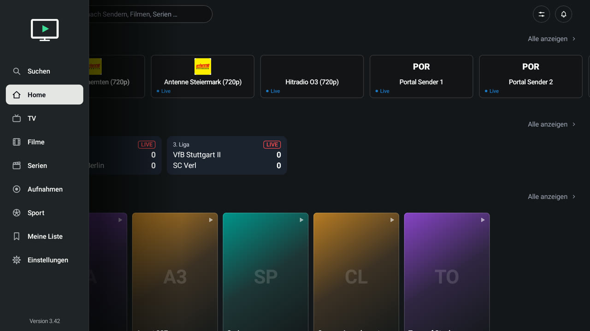
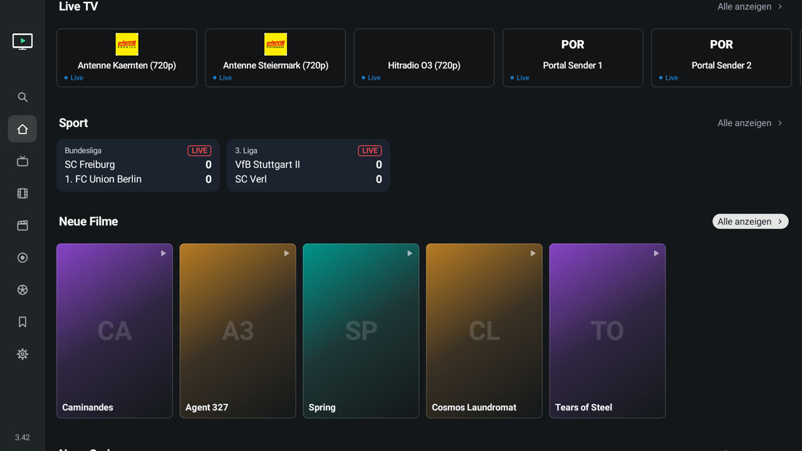
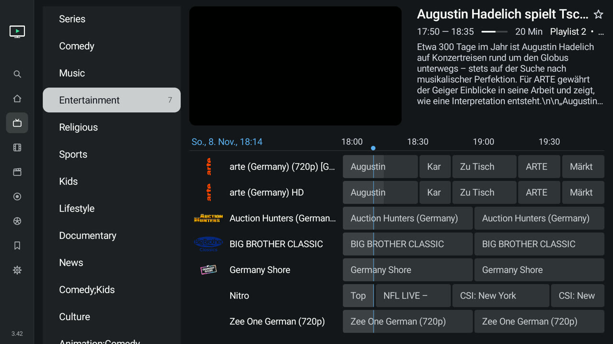
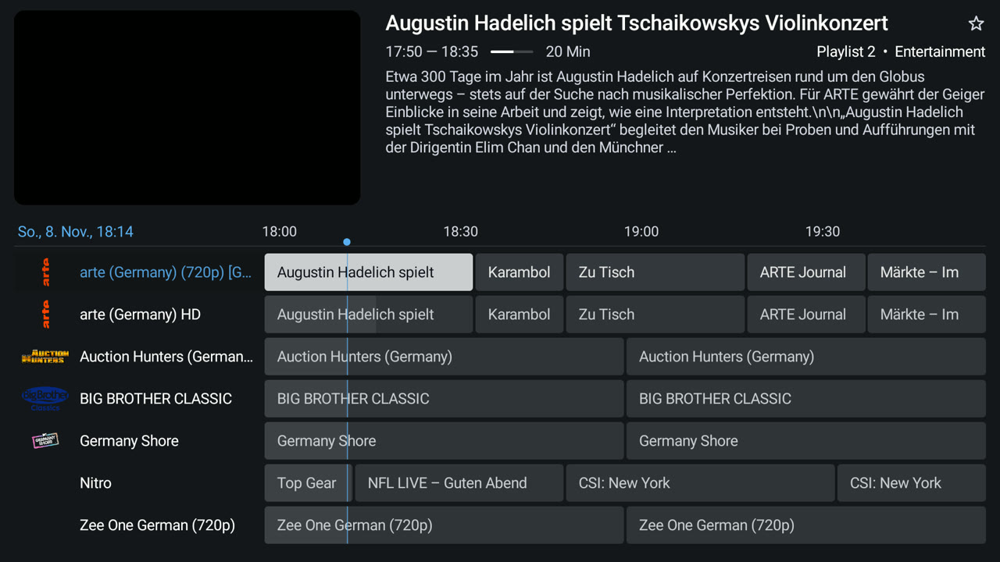
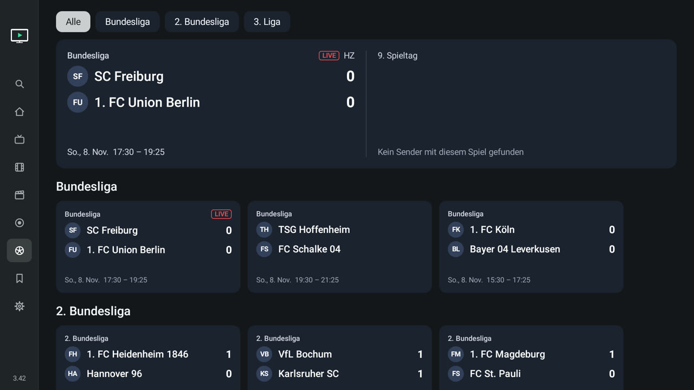
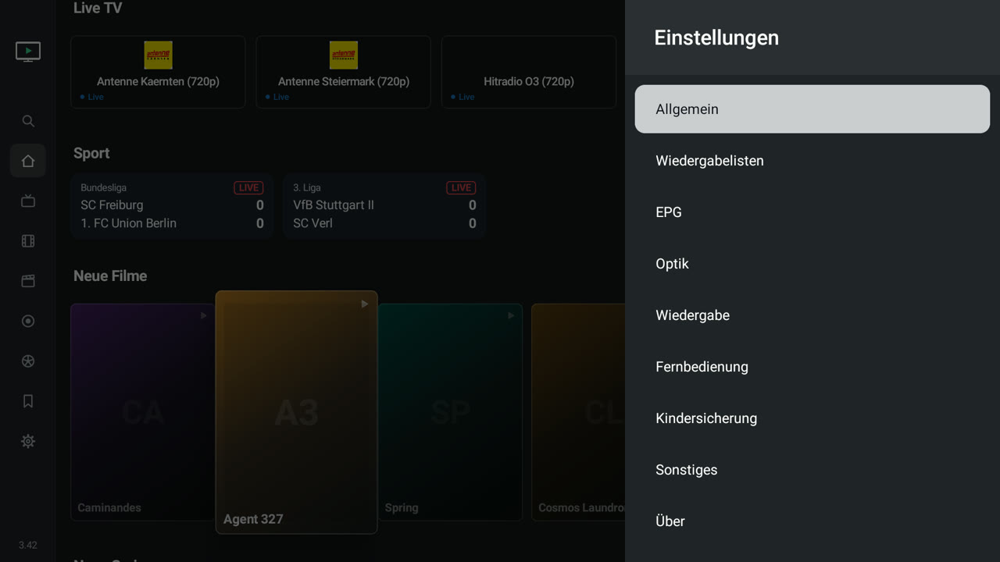

# IPTV-XY

**IPTV-XY Player** ist ein IPTV-Player für **Android TV, Google TV und Amazon Fire TV**, gebaut mit Kotlin, Jetpack Compose und Media3 und ganz auf die Fernbedienung ausgelegt.



> **IPTV-XY liefert keine Inhalte.** Die App enthält keine Sender, Playlists, Filme oder Serien. Sie spielt nur Playlists ab, die du selbst hinzufügst (Xtream-Codes-Zugang, M3U-Adresse oder Stalker-Portal). Nutze nur Quellen, die du rechtmäßig nutzen darfst.

## Grundlage

IPTV-XY basiert auf **[IPVIO Stream](https://github.com/Emrodev/IPVIO-Stream)** von Emrodev und wird unter der GPL-3.0 mit eigenem Namen und Logo weiterentwickelt. Oberfläche und Funktionen wurden seitdem weitgehend neu gebaut.

## Installation auf Fire TV / Android TV

**Downloader-Code: `6420457`** (oder http://aftv.news/6420457)

1. Die kostenlose App **Downloader** (von AFTVnews) aus dem Amazon Appstore oder Google Play installieren.
2. Downloader das Installieren erlauben: Fire TV *Einstellungen > Mein Fire TV > Entwickleroptionen > Unbekannte Apps installieren > Downloader: An*.
3. Downloader öffnen, den Code oben (oder die Adresse unten) eingeben, *Go* drücken und die APK installieren.

Direkter Link zur neuesten Version: https://github.com/Pelzixx/IPTV-XY-Releases/releases/latest/download/iptv-xy.apk

**Updates:** in der App unter *Einstellungen > Über*.

## Funktionen

**Playlists**
- Xtream Codes, M3U-Adresse, lokale M3U-Datei oder Stalker-Portal; mehrere Playlists gleichzeitig
- Zugangsdaten bequem über das Handy im WLAN eingeben (Adresse und Code werden am TV angezeigt)
- Sehr große Listen: Sprachfilter beim Laden, fortsetzbarer Download, Aktualisierung im Hintergrund
- Gruppen und Kategorien in der Reihenfolge des Anbieters oder sortiert, eigene Gruppen, Sender und Gruppen ausblenden oder sperren
- Senderlogos vom Anbieter, aus dem EPG oder aus einem eigenen Ordner, auch bei leicht abweichenden Namen

**Startseite**
- Live TV, Weiterschauen, Favoriten und Empfehlungen
- Aktuelle Sportspiele mit Spielstand, die 5 neuesten Filme und die 5 neuesten Serien
- Menü: Suche, Home, TV, Filme, Serien, Aufnahmen, Sport, Meine Liste, Einstellungen; frei sortierbar, einzelne Punkte ausblendbar; die Version steht unten im Menü

**Suche**
- Sucht in Sendern, laufenden und kommenden Sendungen, Filmen und Serien; auch per Sprache
- Verlauf der letzten Suchen

**TV und TV-Guide**
- Gruppenliste, Senderliste und TV-Guide auf einer Seite, oben läuft die Vorschau mit Ton
- Nahtloser Übergang von der Vorschau ins Vollbild und mit *Zurück* wieder in die Vorschau, ohne Neuladen
- Guide mit Zeitleiste, Fortschritt der laufenden Sendung, Sendernummern, zweizeiligen Titeln und Catch-up-Symbol
- XMLTV-EPG (auch .gz) zusätzlich zum EPG des Anbieters, Sendernamen für die Zuordnung anpassbar
- Archiv/Catch-up bei Sendern, die es anbieten: im Guide zurückgehen und alte Sendungen mit Spulen abspielen
- Favoriten, Verlauf der zuletzt gesehenen Sender, Erinnerungen an Sendungen (auch mit automatischem Umschalten)
- Multi-View (mehrere Sender gleichzeitig) und Bild-in-Bild

**Im Vollbild**
- Taste links öffnet die Senderliste direkt im Ordner des laufenden Senders, mit Programm und Beschreibung
- Hoch/runter schaltet um; Senderwahl per Zifferntasten
- Beim Umschalten eine kleine Info mit Sendung, Uhrzeit, Auflösung (HD/FHD/4K), Bildrate und Tonformat
- Zeitversetztes Spulen bei Catch-up-Sendern

**Aufnahmen**
- Sendungen aufnehmen, auch geplant aus dem Guide, mit Vor- und Nachlaufzeit
- Speicherort im Gerät oder auf einem NAS per SMB

**Sport Guide**
- Spiele aus dem TV-Programm, deutscher Fußball zuerst: Bundesliga, 2. und 3. Liga, DFB-Pokal, Champions League, Europa League, Conference League, Länderspiele, Frauen-Bundesliga, außerdem Formel 1, Handball, Basketball und Eishockey
- Live-Spielstände und Spielminute (mit Halbzeit), Ergebnisse beendeter Spiele
- Die Sender, auf denen das Spiel läuft, inklusive Konferenz; beste Qualität zuerst; ein Klick startet den Sender
- Erinnerung für kommende Spiele

**Filme und Serien**
- Kategorien in der Reihenfolge des Anbieters, Sortierung nach Name, Bewertung, Jahr oder „zuletzt hinzugefügt“
- Detailseite mit Beschreibung, Bewertung, Fortsetzen, Trailer und Meine Liste; Staffeln und Folgen übersichtlich
- Meine Liste und Verlauf

**Player** (Media3 / ExoPlayer)
- Ton- und Untertitelwahl, FFmpeg-Tondecoder für AC3/E-AC3/DTS, Surround und Passthrough
- Bildratenanpassung (AFR), Seitenverhältnis/Zoom, Audioversatz, Schlummertimer
- Wahlweise externer Player
- Der Stream stoppt immer, wenn die App verlassen wird

**Einstellungen**
- Aufbau wie bei bekannten TV-Playern: Allgemein, Wiedergabelisten, EPG, Optik, Wiedergabe, Fernbedienung, Kindersicherung, Sonstiges, Über
- Farbthemen, Schriftgröße und Transparenz der Oberfläche
- Fernbedienung: Belegung der Tasten, Umschaltverzögerung, Sprungweiten beim Spulen
- Kindersicherung mit PIN für Gruppen, Sender und Einstellungen
- Sicherung und Wiederherstellung aller Einstellungen
- Updates direkt in der App (*Einstellungen > Über*)

## Screenshots

Alle Bilder stammen aus einer Test-Installation mit frei verfügbaren Test-Sendern. Das Videobild der Vorschau fehlt auf den Bildern, weil der Fernseher laufendes Video nicht mit aufnimmt.

| | |
|---|---|
| <br>**Startseite** mit Menü | <br>**Startseite** – Live TV, Sport-Ergebnisse, neue Filme |
| <br>**TV** – Gruppen, Sender, Guide und Vorschau | <br>**TV-Guide** – Zeitleiste mit Beschreibung |
| <br>**Sport Guide** – Spiele, Spielstände, Spielminute | <br>**Einstellungen** |

## Eigene API-Schlüssel (optional)

Die App enthält **keine API-Schlüssel**. Bei Xtream-Playlists kommen Beschreibung, Cover und Bewertung direkt vom Anbieter. Der Code kann zusätzlich diese Dienste nutzen:

| Dienst | Wofür | Schlüssel |
|---|---|---|
| TMDB | Poster, Beschreibungen, Besetzung, Trailer, Genres | eigener, kostenlos |
| OMDb | IMDb- und Rotten-Tomatoes-Bewertungen | eigener, kostenlos |
| TheIntroDB | Intro-, Rückblick- und Abspannzeiten | nicht nötig |

Die Eingabeseite für eigene TMDB- und OMDb-Schlüssel ist in der aktuellen Version ausgeblendet. Eingetragene Schlüssel bleiben nur auf dem Gerät.

## Quellen und Danksagungen

- **[IPVIO Stream](https://github.com/Emrodev/IPVIO-Stream)** (Emrodev, GPL-3.0): Ausgangsbasis des Quellcodes.
- **[OpenLigaDB](https://www.openligadb.de/)**: Spielstände im Sport Guide. Die Daten stehen unter der [Open Database License (ODbL 1.0)](https://opendatacommons.org/licenses/odbl/1-0/); in der App wird die Quelle genannt.
- **[StreamVault IPTV](https://github.com/Davidona/StreamVault-IPTV)**: Vorbild für die Idee des Sport Guides. Es wurde kein Code übernommen.
- **TiviMate**: Vorbild für Bedienung und Aufbau mancher Bildschirme. Es wurde kein Code, keine Grafik und kein Logo übernommen; IPTV-XY steht in keiner Verbindung zu TiviMate.
- **TMDB, OMDb, TheIntroDB**: optionale Online-Dienste, siehe oben. *Dieses Produkt nutzt die TMDB-API, ist aber nicht von TMDB unterstützt oder zertifiziert.*
- Bibliotheken und Schriften: siehe [THIRD_PARTY_NOTICES.md](THIRD_PARTY_NOTICES.md).

## Selbst bauen

Voraussetzung: Android Studio mit Android SDK; alles Weitere lädt der Gradle-Wrapper.

```
git clone https://github.com/Pelzixx/IPTV-XY.git
cd IPTV-XY
./gradlew assembleDebug        # Windows: gradlew.bat assembleDebug
```

Die APK liegt danach in `app/build/outputs/apk/debug/`. Tests der reinen Logik: `./gradlew testDebugUnitTest`

## Lizenz

Copyright (C) 2026 IPVIO Stream contributors
Copyright (C) 2026 IPTV-XY contributors

IPTV-XY ist freie Software unter der **GNU General Public License Version 3** (siehe [LICENSE](LICENSE)). Die GPL ist auch deshalb nötig, weil die App den GPL-3.0-lizenzierten FFmpeg-Tondecoder enthält. Verwendete Bibliotheken, Schriften und Dienste stehen in [THIRD_PARTY_NOTICES.md](THIRD_PARTY_NOTICES.md).

Der Name „IPVIO“ und das IPVIO-Logo kennzeichnen das Originalprojekt; IPTV-XY verwendet deshalb einen eigenen Namen und ein eigenes Logo. Wer eine veränderte Fassung veröffentlicht, sollte es ebenso halten.

IMDb, Rotten Tomatoes, TMDB, TiviMate, Android TV, Google TV und Fire TV sind Marken ihrer jeweiligen Inhaber. IPTV-XY steht mit ihnen in keiner Verbindung.

## Haftungsausschluss

Die Software wird ohne jede Gewährleistung bereitgestellt. Die Autoren stellen keine Streams oder Playlists bereit, hosten oder verkaufen sie nicht und sind nicht verantwortlich dafür, wie die App genutzt wird. Playlists ohne Erlaubnis der Rechteinhaber zu nutzen kann in deinem Land verboten sein.
